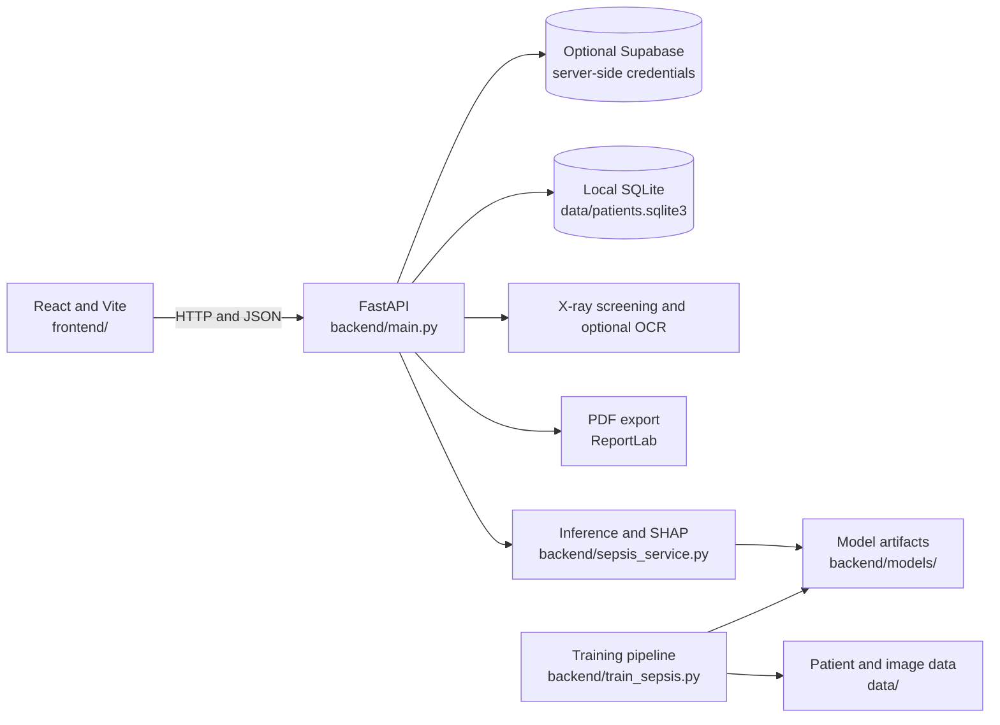

# System architecture

The browser communicates with FastAPI; it never connects directly to the
database or receives Supabase server secrets. SQLite is the local-development
default. Supabase is selected explicitly through the API environment. Patient
datasets, local database files, and model artifacts are separate from source
code so deployments can manage them independently.
